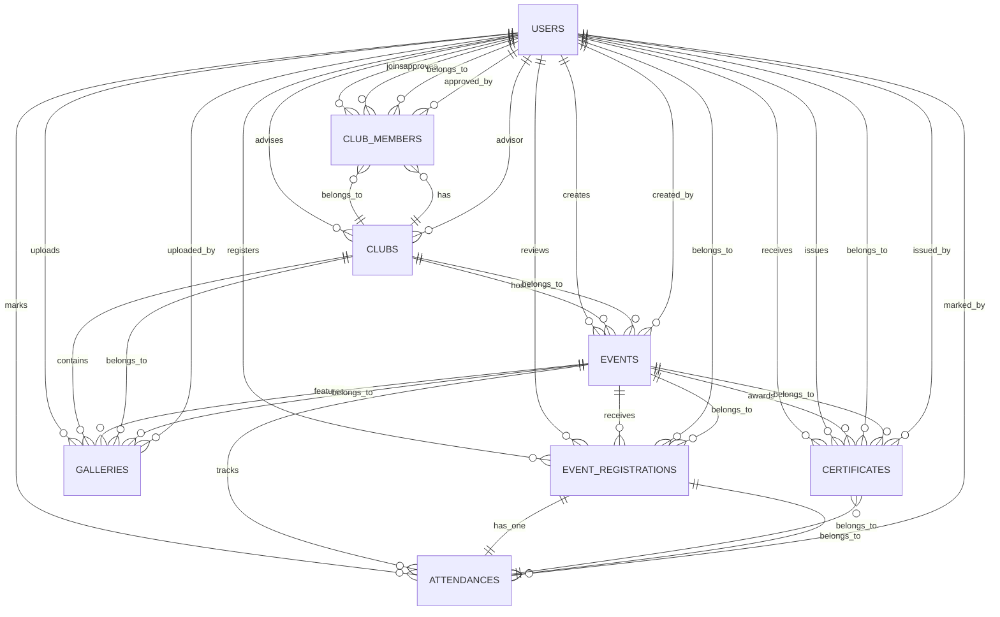

# University Club Management System (UCMS)

University Club Management System (UCMS) is a production-oriented Laravel application for managing university clubs, events, memberships, attendance, gallery uploads, certificates, and authenticated student activity. It is designed for a real university environment where different user roles have different permissions and workflows.

The project focuses on a clean, responsive interface and a practical backend architecture. Students can browse clubs, join clubs, register for events, view notifications, and download certificates. Super Admins and Club Leaders can manage club and event operations, review registrations, mark attendance, and generate certificates.

## What This Project Does

UCMS centralizes the full student club lifecycle:

- Club discovery and club profile pages
- Club membership requests and member management
- Event creation, updates, and cancellations
- Event registration and review workflow
- Attendance tracking for event participants
- Gallery uploads for club and event media
- Certificate generation and PDF download
- User authentication and role-based access control
- Profile editing, search, and notifications
- Dashboard summaries for admins and students

## Main Features

### Authentication

- Login
- Register
- Forgot password
- Reset password
- Logout

### Dashboards

- Super Admin dashboard with live counts and account overview
- Student dashboard with personalized membership and registration summaries
- Profile completion indicator

### Clubs

- View all clubs
- Create, edit, and delete clubs
- Club detail pages
- Join and leave club workflow
- Member role assignment

### Events

- Create, edit, and delete events
- Browse event listings and event details
- Register for events
- Approve or review registrations
- Cancel registrations

### Attendance

- Mark attendance for approved registrations
- Track present/absent status

### Gallery

- Upload club/event images
- Update captions and delete media

### Certificates

- Generate certificates for present attendees
- Store generated PDF files in public storage
- Download certificate PDFs

### Profile, Search, and Notifications

- Update profile information
- Search across the UCMS workspace
- View notifications and mark them as read

## Technology Stack

### Backend

- Laravel 12
- PHP 8.2+
- Eloquent ORM
- Form Request validation
- Middleware-based authorization

### Frontend

- Blade templates
- Tailwind CSS via Vite
- Vanilla JavaScript where needed

### Database and Storage

- MySQL-compatible schema
- Laravel Storage for uploads and generated files
- Public disk for media and certificate PDFs

### PDF Generation

- barryvdh/laravel-dompdf

### Testing

- Pest 3
- Laravel feature tests

## User Roles

UCMS uses role-based access control with three system roles.

### Super Admin

Super Admins can manage the entire platform:

- Dashboard access
- Manage clubs
- Manage events
- Manage members
- Approve club join requests
- Assign club leaders
- Assign member roles
- Upload gallery media
- Manage attendance
- Generate certificates
- View reports and summaries

### Club Leader

Club Leaders manage only their assigned club:

- Dashboard access
- Create and update events
- Cancel events
- View club members
- Approve event registrations
- Upload gallery media
- Take attendance
- Generate certificates

Club Leaders cannot manage clubs they do not own and cannot access Super Admin-only operations.

### Student

Students can use the platform as participants:

- Register and log in
- Browse clubs
- Search clubs and events
- Join clubs
- Leave clubs
- View events
- Register for events
- Cancel event registrations
- View gallery images
- Download certificates
- Edit profile information

## Application Workflow

### 1. Authentication Flow

1. A visitor registers or logs in.
2. Laravel authenticates the user.
3. The system assigns access based on the user role.
4. The user lands on the dashboard.

### 2. Club Workflow

1. Super Admin or Club Leader creates or updates a club.
2. Students browse clubs and request membership by joining.
3. Membership records are stored in the club members table.
4. Leaders and admins can review, assign roles, or remove members.

### 3. Event Workflow

1. A Super Admin or Club Leader creates an event under a club.
2. Students browse events and submit registrations.
3. Registrations are reviewed and approved or rejected.
4. Approved participants can attend the event.

### 4. Attendance and Certificate Workflow

1. Attendance is recorded for approved registrations.
2. If a participant is marked present, a certificate can be generated.
3. The system creates a PDF using DomPDF.
4. The certificate is stored in public storage and can be downloaded later.

### 5. Gallery and Notification Workflow

1. Club Leaders or Super Admins upload event or club photos.
2. Users receive system notifications for relevant actions.
3. Notifications can be viewed and marked as read.

## Architecture Overview

UCMS follows a Laravel MVC style architecture with role-aware controllers and form requests.

### Layers

- Route layer: defines public, authenticated, and role-protected routes
- Controller layer: handles request flow and orchestrates domain actions
- Form Request layer: validates input for create/update/review operations
- Model layer: defines Eloquent relationships and domain behavior
- View layer: renders Blade-based pages for dashboards and modules
- Storage layer: manages uploaded files and generated PDFs

### Key Architectural Decisions

- Role middleware is registered in the application bootstrap and used on sensitive routes.
- Form requests are used for validation instead of inline controller validation.
- Eloquent strict mode is enabled during development to catch lazy loading and model issues.
- Certificate PDFs are generated through a dedicated controller action and saved to storage.
- Blade layouts keep the public and authenticated experiences visually consistent.

## Domain Models and Relationships

The main data model is centered on users, clubs, events, registrations, attendance, media, and certificates.

### Core Entities

- User
- Club
- ClubMember
- Event
- EventRegistration
- Attendance
- Gallery
- Certificate

### Relationship Summary

- A User can have many club memberships.
- A User can have many event registrations.
- A User can upload many gallery items.
- A User can receive many certificates.
- A Club can have many members.
- A Club can have many events.
- A Club can have many gallery items.
- An Event belongs to a Club.
- An Event can have many registrations.
- An Event registration belongs to a User and an Event.
- Attendance belongs to a registration.
- A Certificate belongs to a User, Event, and Attendance record.

## ER Diagram



## Project Structure

- `app/Http/Controllers` - module controllers and authentication controllers
- `app/Http/Requests` - validation classes
- `app/Http/Middleware` - role authorization middleware
- `app/Models` - Eloquent domain models
- `database/migrations` - database schema
- `resources/views` - Blade UI for public, auth, and module pages
- `resources/css` - Tailwind-driven styling
- `resources/js` - shared frontend behavior
- `routes/web.php` - application route map
- `tests/Feature` - end-to-end feature coverage

## Installation

### Prerequisites

- PHP 8.2 or later
- Composer
- Node.js and npm
- MySQL or a compatible database
- A local PHP runtime such as XAMPP on Windows

### Setup Steps

1. Clone the repository.
2. Install PHP dependencies:

```bash
composer install
```

3. Install JavaScript dependencies:

```bash
npm install
```

4. Create the environment file:

```bash
copy .env.example .env
```

5. Generate the application key:

```bash
php artisan key:generate
```

6. Configure your database connection in `.env`.
7. Run migrations:

```bash
php artisan migrate
```

8. Create the storage symlink for uploads and certificate files:

```bash
php artisan storage:link
```

9. Build frontend assets:

```bash
npm run build
```

## Running the Project

### Development Mode

Run the application and frontend watcher together:

```bash
php artisan serve
npm run dev
```

### Test Suite

Run the automated tests:

```bash
php artisan test
```

### Code Quality

If you use Laravel Pint, run formatting before committing changes:

```bash
./vendor/bin/pint
```

## How To Use UCMS

### As a Student

1. Register an account.
2. Log in and open the dashboard.
3. Browse clubs and event listings.
4. Join clubs you are interested in.
5. Register for approved events.
6. Check your notifications for status updates.
7. Download certificates when they become available.

### As a Club Leader

1. Log in with a club leader account.
2. Open the dashboard for club summaries.
3. Manage events for your assigned club.
4. Review event registrations.
5. Mark attendance after the event.
6. Generate certificates for present attendees.
7. Upload gallery images for club activities.

### As a Super Admin

1. Log in with a super admin account.
2. Manage clubs and event operations across the platform.
3. Review membership and registration records.
4. Assign member roles or club leaders.
5. Manage attendance and certificates.
6. Review dashboard metrics and system activity.

## Routes Overview

The application includes:

- Public home page
- Authentication routes for login, register, forgot password, and reset password
- Authenticated dashboard route
- Profile, search, and notifications routes
- Club, event, member, registration, gallery, attendance, and certificate routes
- Role-protected create/update/delete actions for admin and club leader workflows

## Validation and Testing

The project has been validated with syntax checks and feature testing for the authentication and core club/event flows. The codebase is structured to support additional feature tests for attendance, certificates, search, and notification handling.

## Notes

- UCMS is designed as a real university system, not a mock CRUD demo.
- The frontend uses Tailwind CSS through Vite rather than a CDN-only setup.
- Certificate PDFs are generated with DomPDF and stored through Laravel Storage.
- Role-based access is enforced through middleware and model-level helpers.

## License

This project is open-sourced software under the MIT license, following the Laravel framework license conventions.
